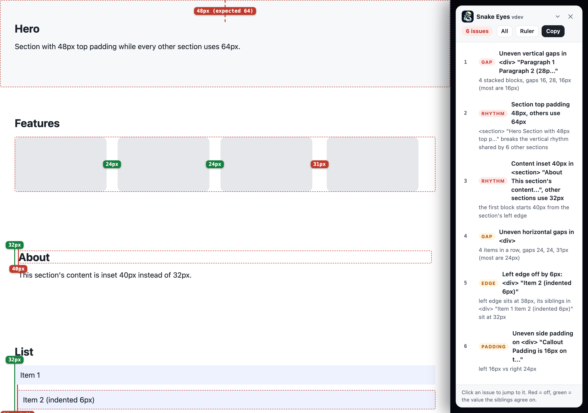

#  Snake Eyes

Spacing auditor for any page, in your browser.

Click the icon and it reads the page the way a picky designer does: uneven gaps, an item nudged 6px right, a heading at 2 sizes. It draws the guides with the numbers and hands you a report your agent can act on. Nothing runs until you click, nothing leaves the browser.



[](https://github.com/bunlongheng/snake-eyes/actions/workflows/ci.yml)
[](LICENSE)


## Features

- **One click, nothing before it** - `activeTab` and `scripting` only, no background scanning.
- **5 checks on the rendered layout** - bounding boxes, 2px tolerance.
- **Every finding says where and why** - selector, the count behind it, the reason.
- **A report you can paste** - selector, found, why, expected.
- **A whole site in 1 command** - same engine, plus a link check.
- **4 ways to look** - guides, X-ray, Heat, Night, and a Ruler over any of them.
- **Silence you can trust** - 14 shapes it refuses to guess at.

## Quick start

1. `chrome://extensions`, turn on **Developer mode**, **Load unpacked**, pick this folder.
2. Pin the icon. Click to audit, click again to clear. `Alt+Shift+S` also works.

For `file://` pages, enable **Allow access to file URLs** on its details page.

## What it catches

| Check | What it compares |
|-------|------------------|
| Gap | 3 or more siblings in a row, or stacked blocks |
| Edge | Left and right edges of stacked siblings |
| Padding | Left vs right, on boxes whose edges are drawn |
| Section | Top and bottom padding, and the content inset in each |
| Type | `font-size` across every `<h1>`-`<h6>` and `<p>` of a kind |

High is 8px off or more, medium 5 to 7, low 3 to 4. Under 2px, nothing. Resize and the panel greys out. For a state behind a click, open it and press **Re-scan**.

## What it never flags

Each row is a rule with a real page behind it.

| Shape | Why |
|-------|-----|
| Siblings of different kinds | A heading against a card compares nothing |
| Runs of text | A paragraph with links has uneven gaps by nature |
| Centered groups | Meant to have different edges |
| Inline and inline-block | A code chip starts where the words reach it |
| Shadow roots and iframes | The scan walks the main document only |
| Type doing another job | A 48px `<p>` beside 16px copy is a hero line |
| Type under utility classes | `text-lg` puts every size in its own group |
| Type in another region | Footer microcopy is not body copy |
| A component outvoting the page | 1 vote per strip: 6 cards cannot outvote 2 headings |
| Padding on an invisible box | No drawn edge, nothing to be off centre from |
| A box edge nothing paints | A negative-margin row hangs left of its own content |
| A 2-up row read as a stack | Centred columns have different tops |
| A gap somebody typed | Excess equal to a margin on a different-kind item |
| Non-`<section>` sections | The Section check needs real section tags |

## A whole site, not 1 page

```bash
npm run crawl -- https://example.com --depth 1 --out site-report.md
```

Every page on the origin, every link it finds, 1 report.

| Flag | Default | What it does |
|------|---------|--------------|
| `--depth` | `1` | Hops to follow |
| `--max` | `25` | Cap on pages |
| `--width` | `1280` | Width to measure at |
| `--out` | stdout | Write to a file |

| Verdict | Statuses |
|---------|----------|
| Dead | 404, 410, no DNS, connection refused |
| Broken | 5xx |
| Unverified | 401, 403, 429, 999. Declining a crawler is not being dead |

A script and not a button: reading a second page needs permission to read every site you visit.

## The panel

Docks at 1200px or wider: the page narrows to 80% so no guide is covered, and the scan runs after the dock, so the report quotes the width it measured. Narrower, it floats. Phone-sized, a bottom sheet.

| View | What it is for |
|------|----------------|
| Guides | The page untouched, carrying every number |
| X-ray | A radiograph: the deeper a box, the brighter it reads |
| Heat | Where to look. Green clear, yellow an area, red the measurement |
| Night | Which box. Green phosphor, lighting only the findings |
| Ruler | A switch, not a view. Every container labelled in px |

- Every guide is drawn on open. Clicking a row narrows to that 1 finding, lens kept.
- The list follows the page: the finding you scroll to selects itself.
- Sorted high to low, capped at 150, and it says when it dropped any.

## The report

```markdown
## 1. Uneven vertical gaps in <div> "Paragraph 1 Paragraph 2..." (high)
- Selector: `section#stack > div > div.stack`
- Found: 4 stacked blocks, gaps 16, 28, 16px (most are 16px)
- Why it matters: A stack with 1 gap out of step reads as 2 groups, not 1 list.
- Expected: 16px between every block
```

Origin and path only, never the query string.

## How it works

| Diagram | What it shows |
|---------|---------------|
| [Architecture](https://flows-bheng.vercel.app/?id=68d4e219-832e-4ad3-b801-6494b1089e3a) | The pieces, and the crawl reusing them |
| [Click to report](https://sequences-bheng.vercel.app/d/934d6cbc-86d6-4650-9934-78683b094f6c) | Click to clipboard, and the teardown |

[](https://sequences-bheng.vercel.app/d/934d6cbc-86d6-4650-9934-78683b094f6c)

It adds 1 element, `#snake-eyes-root`, with a closed shadow root inside. Page CSS cannot restyle it, page script cannot reach it, and your DOM is never edited.

## Privacy

No background scanning, no network request, no storage, no analytics. The report holds origin and path, your viewport, selectors and short labels.

## Layout and tests

```
background.js   click, inject, clean up
lib/pure.js     the math, no DOM
overlay.js      scan, analyze, report, mount
panel.css       panel and guides
overlay.css     1 rule for the host
scripts/        crawl, pack, icons, version
preview/        the overlay as a plain page
tests/          3 fixtures, 3 suites
```

```bash
npm install && npx playwright install chromium
npm test      # unit, the overlay, the packed extension
npm run lint  # eslint, zero warnings
```

CI runs all of it on every push and pull request. A `v*` tag attaches a zip to the release.

## Decisions

| Decision | Why |
|----------|-----|
| Measure the rendered layout | What the eye sees is the bounding box |
| A real majority, or silence | 3 buttons at natural widths agree on nothing |
| 1 vote per page strip | A component rendered 6 times is 1 decision, not 6 votes |
| Only measure edges you can see | A box edge nothing paints is not an edge |
| 2px tolerance | Subpixel noise is 1px, and 3px is where a human notices |
| Report first, pictures second | Guides exist so you trust the report before pasting |
| No background scanning | An audit on every page load is noise and a privacy problem |
| Cap after sort | Past 150, the ones kept are the worst |

---

<div align="center">

<a href="https://bunlongheng.com"></a>
<a href="https://www.linkedin.com/in/bunlongheng/"></a>
<a href="https://www.instagram.com/ibunlong/"></a>
<a href="mailto:bheng.code@gmail.com"></a>

<br>

Built by **[Bunlong](https://bunlongheng.com)** &nbsp;&middot;&nbsp; [more apps](https://bunlongheng.com/projects)

</div>
